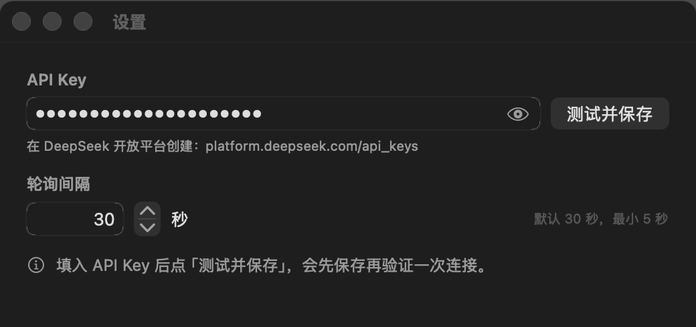

# DeepSeek 余额指示器

macOS 菜单栏应用，实时显示 DeepSeek 账户余额。Swift 原生（AppKit + SwiftUI），无第三方依赖。


## 构建运行

```bash
./scripts/build-app.sh
open build/DeepSeekBalanceIndicator.app
```

应用只驻留菜单栏（`LSUIElement`，无 Dock 图标、无主窗口），首次启动会自动弹出设置窗口。

## 设置



- **API Key** — 在 [platform.deepseek.com/api_keys](https://platform.deepseek.com/api_keys) 创建，输入框右侧的眼睛图标切换明文 / 隐藏
- **轮询间隔** — 默认 30 秒，最小 5 秒

「测试并保存」先保存两项设置，再用刚填的 Key 请求一次接口，把结果显示在下方。

菜单：余额明细、立即刷新 ⌘R、设置 ⌘,、关于、退出 ⌘Q。未配置 Key 时只有「点击配置 API Key…」一项。

## 说明

- 余额来自 `https://api.deepseek.com/user/balance`，API Key 只保存在本机 `UserDefaults`，不会上传到任何地方。
- 请求失败时菜单栏显示 `--`，菜单里用红色写明原因（401、网络错误等），并保留上一次成功的余额。
- 菜单栏图标是模板图标，只取 alpha 通道，跟随系统自动变白 / 变黑；图标素材来自 DeepSeek，版权归 DeepSeek 所有。
- 退出请用菜单里的「退出」，应用没有 Dock 图标。

## 开发

```bash
./scripts/make-icon.sh            # 由 icon.svg 生成菜单栏图标与应用图标
./scripts/make-screenshots.sh     # 重新生成 docs/ 里的截图

# 不需要显示器即可验证打包结果与网络链路
build/DeepSeekBalanceIndicator.app/Contents/MacOS/DeepSeekBalanceIndicator --self-test
```

`--self-test` 会启动状态栏、跑一次请求、打开两个窗口并打印实际渲染结果后退出。`--endpoint <url>` 可把请求指向本地桩服务，`--capture <dir>` 可把界面渲染成 PNG。
